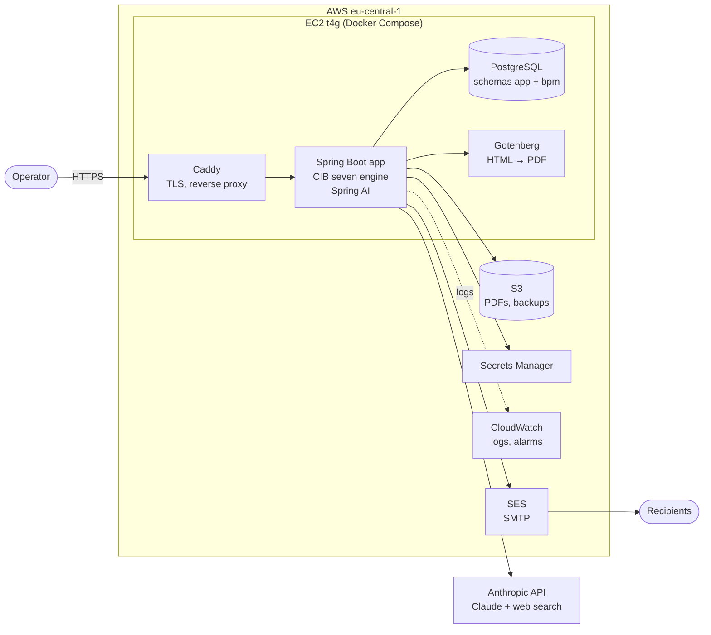
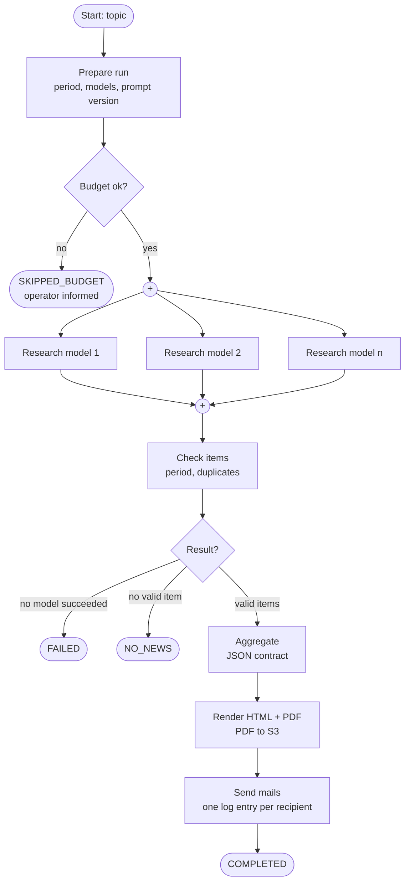

# AI News Digest

AI News Digest asks several AI models in parallel for the news of the past period on topics you define, checks what they return (period, sources, duplicates), lets an aggregator model condense it and sends the result as an HTML mail with a one-page PDF infographic. A BPMN process in [CIB seven](https://cibseven.org) runs every digest; models, topics, schedules and recipients live in PostgreSQL, never in the process or the code. Every AI call is costed, and a monthly budget limits the spending.

The project is also a learning exercise: how to combine business process management with LLM calls in a clean way.

> The detailed documentation in [`ai-news-digest/docs/`](ai-news-digest/docs/README.md) is written in German. This README is the English overview.

## Status

Proof of concept, running in production on AWS (`eu-central-1`) since November 2026, with one research model (Claude Sonnet 5.5) and one topic. Progress is tracked in the [roadmap](ai-news-digest/docs/13-roadmap.md).

| Done | Planned |
|---|---|
| BPMN process with parallel research, checks, aggregation, PDF, mail | More providers and real parallelism (step 13) |
| Anthropic via Spring AI with web search, cost per call | URL check with SSRF protection, duplicates across runs (14) |
| Versioned prompts, eval profile with search diagnosis | Budget gateway and cost reports (15) |
| Docker image, production Compose with Caddy | Scheduler from the database, start/stop of the instance (16) |
| AWS with Terraform, SES, S3, Secrets Manager, backups | Final infographic design (17), metrics and alarms (18) |
| CI (tests, coverage, Trivy) and CD (approval, SSM, rollback) | REST API, Keycloak, React UI (19–24) |

## Architecture



- **Spring Boot backend** with the embedded **CIB seven** engine (Camunda 7 fork). The process `digestRun` orchestrates a run; thin delegates call services.
- **PostgreSQL** holds the configuration (providers, models with prices, topics, schedules, recipients) and all results in schema `app`, and the engine tables in schema `bpm`. Both are created by Flyway.
- **AI providers** sit behind a `NewsProvider` interface. A new model of a connected provider is a database row; a new provider is one more implementation. Anthropic is connected through Spring AI.
- **Gotenberg** (headless Chromium) renders the PDF from the same Thymeleaf data as the mail.
- **Production:** one EC2 instance without a load balancer. Caddy terminates TLS (Let's Encrypt), the app reads its secrets from AWS Secrets Manager, PDFs and nightly database dumps go to S3, mails go through the SES SMTP interface.

## How a run works



1. The run is prepared and the monthly budget is checked.
2. All research models of the topic search the web **in parallel** (parallel multi-instance between two parallel gateways) with the same versioned prompt. Each returns news items as JSON: headline, summary, URL, publication date.
3. A failing model is recorded as `FAILED`; the others go on. Only when all have ended does the process continue.
4. The items are checked: outside the period, duplicate within the run. Checking that the source is reachable and that an item was not reported in an earlier run follows in step 14.
5. The aggregator model condenses the valid items into a structured digest.
6. HTML mail and PDF are rendered from the same data and sent to the recipients of the topic. A retried mail job never sends a mail twice.

Everything an LLM returns is treated as untrusted: texts are escaped in HTML and PDF, and source URLs will only be fetched with SSRF protection (step 14).

Details: [process](ai-news-digest/docs/04-prozess-bpmn.md), [architecture and packages](ai-news-digest/docs/02-architektur.md), [data model](ai-news-digest/docs/03-datenmodell.md), [prompts and eval history](ai-news-digest/src/main/resources/prompts/README.md).

## Tech stack

| Area | Choice |
|---|---|
| Backend | Java 21, Spring Boot 4.1, Spring Data JPA, Spring Mail, Jackson 3 |
| Process engine | CIB seven 3.0 (embedded) |
| AI | Spring AI 2.0 with Anthropic (Claude Sonnet 5.5, web search) |
| Database | PostgreSQL 18, Flyway, Hibernate `ddl-auto=validate` |
| PDF | Thymeleaf HTML rendered by Gotenberg |
| Tests | JUnit 5, Testcontainers, JaCoCo thresholds; never real AI, mail or AWS calls |
| Runtime | Docker Compose, Caddy |
| AWS | EC2 (Graviton), EBS, S3, SES, Secrets Manager, ECR, Route 53, CloudWatch, SSM |
| Infrastructure | Terraform with an S3 backend |
| CI/CD | GitHub Actions: CI, Terraform plan/apply, CD with approval via OIDC |
| Planned | Keycloak, REST API with springdoc, React + TypeScript + shadcn/ui |

## Repository layout

```
.github/workflows/      ci.yml, cd.yml, infra.yml
ai-news-digest/
  src/main/java/        de.fuechsle.ainewsletter (packages in docs/02-architektur.md)
  src/main/resources/   processes/digest-run.bpmn, prompts/, templates/, db/migration/
  docker/               Caddy, PostgreSQL init, smoke test
  infra/terraform/      AWS infrastructure
  infra/server/         deploy, backup and SSM helper scripts
  infra/cd/             scripts used by cd.yml
  docs/                 concept, architecture, ADRs, runbooks (German)
```

## Run it locally

Requirements: Java 21, Docker. In `ai-news-digest/`:

```bash
cp .env.example .env              # add your Anthropic API key
docker compose up -d              # PostgreSQL, Mailpit, Gotenberg
./mvnw clean verify               # build, tests, coverage (Docker must run)
./mvnw spring-boot:run -Dspring-boot.run.profiles=dev
```

Models and topics are database rows; until the UI exists, they are added with SQL. A run is started with `POST /dev/topics/{topicId}/runs` (profile `dev` only), and the mail shows up in Mailpit at http://localhost:8025. The full walkthrough, including the `eval` profile that exports results and search traces for prompt work, is in the runbook [lokaler-testlauf.md](ai-news-digest/docs/betrieb/lokaler-testlauf.md).

## Deployment

- **CI** (`ci.yml`): build, tests, coverage thresholds, formatting, dependency review, image build with Trivy scan and a Compose smoke test.
- **CD** (`cd.yml`): after a green CI on `main`, it waits for approval in the GitHub environment `prod`, builds the arm64 image, pushes it to ECR, deploys it via SSM, runs an HTTPS smoke test and rolls back to the previous release if anything fails. AWS access uses OIDC only, no stored keys.
- **Infrastructure** (`infra.yml`): Terraform plan on pull requests, apply by hand with approval.

Runbooks (German): [AWS bootstrap](ai-news-digest/docs/betrieb/aws-bootstrap.md), [deployment and rollback](ai-news-digest/docs/betrieb/deployment.md), [first production run](ai-news-digest/docs/betrieb/erster-produktionslauf.md), [restore](ai-news-digest/docs/betrieb/wiederherstellung.md).

## Design decisions

The reasons behind the main choices are recorded as ADRs in [`docs/entscheidungen/`](ai-news-digest/docs/entscheidungen/), for example:
- CIB seven as process engine
- model choice in the database, not in BPMN
- parallel research as multi-instance
- hosting without a load balancer
- Terraform
- English prompts and digest
